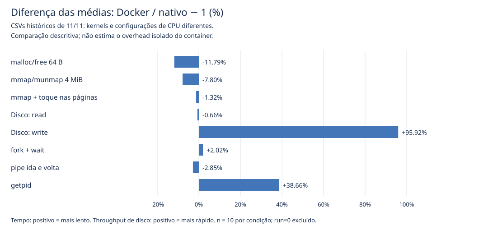

# INF0336 - Seminário

## Título do Seminário

**Quanto custa a abstração? Medindo containers e monitoramento de arquivos no Linux**

## Equipe:

- 202003564 — GABRIEL FREITAS DOS REIS
- 202401787 — HENRIQUE SIQUEIRA DE MAGALHAES
- 202401795 - JÚLIA MANCINE OLIVEIRA E CARVALHO

Disciplina: INF0336 — Sistemas Operacionais, UFG. Professor: Aldo Díaz. Apresentação final: 26/11/2026.

## Apresentações

1. Primeiro checkpoint: TODO: inserir link dos slides. [Relatório da entrega 1](docs/relatorio/checkpoint-1.md).
2. Apresentação final: TODO: inserir link dos slides.

## Resumo

Containers e mecanismos de notificação de arquivos simplificam a execução e a observação de aplicações, mas seus custos dependem da carga e do ambiente. Este estudo investiga operações básicas do sistema operacional e compara polling com `inotify`. Utilizamos cinco micro-benchmarks em C, monitores Python e CSVs produzidos pelo grupo. Analisamos as coletas Linux existentes e executamos nova coleta no Docker Desktop, além de polling nativo no macOS, com aquecimento e dez rodadas válidas. As hipóteses originais preveem overhead próximo de zero em CPU e memória e diferenças em I/O e monitoramento. Nos CSVs Linux, a diferença de tempo foi de +2,03% para `fork + wait` e +38,66% para `getpid`, mas kernels e configurações de CPU diferem entre as condições. Na demonstração Docker, o `inotify` registrou 21 criações e 21 remoções por rodada, enquanto o polling de 50 ms registrou médias de 1,2 criações e 1,2 remoções. Os resultados demonstram diferenças entre operações e limitações do polling, mas ainda não estabelecem um overhead geral de 2% a 5% nem concluem a comparação controlada em Linux.

## Introdução


### Motivação e delimitação

Aplicações precisam de ambientes de execução reproduzíveis e de mecanismos para perceber alterações em arquivos. Containers atendem à primeira necessidade ao empacotar aplicações e isolar processos, enquanto o monitoramento de arquivos aparece em ferramentas de desenvolvimento e rotinas de sincronização e observabilidade. Esses recursos utilizam serviços do sistema operacional, cujo custo pode variar conforme a operação e o ambiente.

O projeto estuda duas situações relacionadas. A Parte A compara operações básicas em C, executadas diretamente em Linux e em containers Docker. A Parte B compara polling e `inotify` no monitoramento de diretórios. A Parte C pretende conectar os experimentos ao repetir o monitoramento em diferentes configurações de armazenamento de containers. O trabalho avaliará uma configuração experimental explicitamente documentada, sem pretender estabelecer um custo universal para containers ou generalizar micro-benchmarks para todas as aplicações.

### Revisão bibliográfica

Felter et al. (2015) comparam Docker e KVM e observam desempenho igual ou superior dos containers ao das máquinas virtuais na maioria das cargas estudadas. Também destacam a necessidade de ajustes em aplicações intensivas em I/O. Esse resultado motiva a separação das operações neste projeto, mas não demonstra que Docker tenha overhead zero em relação à execução nativa em qualquer configuração [1].

O manual de `inotify` descreve notificações de alterações em arquivos e diretórios, incluindo criação, modificação e remoção. A fila tem capacidade limitada e registra `IN_Q_OVERFLOW` quando transborda. Além disso, eventos idênticos consecutivos podem ser agrupados antes da leitura. Assim, contar notificações não equivale necessariamente a contar operações realizadas pela aplicação [2]. Neste projeto, a avaliação distinguirá operações não observadas, agrupamento e ocorrência explícita de overflow.

A documentação do kernel descreve como OverlayFS combina camadas e realiza *copy-up* quando uma operação exige copiar um arquivo da camada inferior para a superior [3]. A documentação do Docker explica que volumes armazenam os dados fora da camada gravável do container, evitando o caminho de escrita dessa camada [4]. Essas fontes justificam comparar camada overlay, bind mount e volume, sem assumir antecipadamente uma ordem de desempenho para a latência dos monitores. Arquivos criados diretamente na camada superior não exercitam o mesmo caminho de *copy-up* de arquivos preexistentes na imagem.

Mytkowicz et al. (2009) mostram que escolhas aparentemente pequenas na configuração podem introduzir viés nas medições de desempenho [5]. Georges, Buytaert e Eeckhout (2007) discutem a importância de repetições e intervalos de confiança, em um estudo voltado a Java [6]. O presente trabalho adotará os princípios de explicitar a configuração e quantificar a variabilidade, sem transferir resultados numéricos de Java para C ou Python. Repetir uma configuração enviesada não elimina seu viés.

### Objetivos e perguntas de pesquisa

**Objetivo geral:** avaliar os custos de execução e de observação de eventos associados a containers e ao monitoramento de arquivos no Linux.

| Pergunta | Experimento e objetivo específico |
|---|---|
| Q1. Quanto Docker altera o custo de operações básicas do SO? | Comparar syscall, criação de processos, comunicação por pipe, I/O e alocação de memória entre execução nativa e container. |
| Q2. Como polling e `inotify` se comparam sob carga crescente? | Medir CPU, latência e operações não observadas para diferentes taxas e intervalos de polling. |
| Q3. O armazenamento do container altera o monitoramento? | Repetir a comparação em camada overlay, bind mount e volume Docker. |

### Hipóteses registradas antes das medições

Reprodução das hipóteses da proposta original, sem alteração após resultados:

- CPU e memória: overhead próximo de zero, pois o container compartilha o kernel do host.
- Syscalls e I/O de disco: possível diferença por causa de overlayfs, seccomp e limites de cgroups.
- `inotify`: menos CPU e menor latência que polling, mas com risco de perda de eventos sob carga alta (`IN_Q_OVERFLOW`).
- Dentro de container: latência/perda podem variar entre overlay, bind mount e volume.

**Nota metodológica anterior à coleta:** compartilhar o kernel fundamenta uma expectativa, mas não garante igualdade de desempenho. O experimento básico estima a diferença do conjunto da configuração. Atribuir uma diferença especificamente a seccomp, cgroups ou OverlayFS exigiria variar esse fator isoladamente.

## Metodologia

### Conjunto de dados e estado da coleta

Os dados são experimentais, produzidos pelos componentes do repositório; não são números extraídos da literatura. O [checkpoint 1](docs/relatorio/checkpoint-1.md) registra o plano original e permanece preservado. Esta atualização, de **23/11/2026**, distingue o que foi executado do que continua planejado:

| Conjunto | Origem e condição | Alcance |
|---|---|---|
| Linux histórico, 11/11 | [Nativo](bench_c/resultados/native.csv) e [Docker-bind](bench_c/resultados_docker/docker-bind.csv), com 10 rodadas válidas e run=0 | Comparação descritiva; configurações não equivalentes |
| Docker Desktop, 23/11 | [CSV bruto C](analysis/coleta_2026-11-23/docker-desktop/benchmarks_raw.csv), 10 rodadas válidas e run=0 | Nova execução real dos cinco benchmarks no Linux da VM |
| Polling macOS, 23/11 | [Logs e metadados](analysis/coleta_2026-11-23/macos-native/), 10 rodadas válidas e run=0 | Execução nativa apenas do monitor portável |
| Polling/inotify Docker, 23/11 | [Logs por rodada](analysis/coleta_2026-11-23/docker-desktop/monitor-repetitions/), 10 rodadas válidas e run=0 | Demonstração em diretório na camada gravável do container |

O conjunto Linux contém 88 linhas por condição: oito métricas × onze rodadas. O aquecimento é excluído, restando dez valores por métrica. Nenhum outlier válido foi removido. Os benchmarks foram executados sequencialmente, em ordem fixa; esta coleta não implementa a aleatorização por blocos proposta no checkpoint. Descartar run=0 não comprova cache frio ou estabilização.

### Modelos, tecnologias e infraestrutura

**Linux histórico:** AMD Ryzen 7 5825U, x86-64, Btrfs. O [metadado nativo](bench_c/resultados/native.info.txt) registra kernel `7.3.0-4-cachyos`, GCC 16.2.1 e afinidade na CPU 2, com 16 CPUs visíveis; o [metadado Docker](bench_c/resultados_docker/docker-bind.info.txt) registra kernel `7.3.3-1-cachyos`, uma CPU visível e ausência de afinidade registrada pelo script. A versão do compilador do container está vazia. Não há comprovação de identidade dos binários, parâmetros completos ou commit dessas execuções. Portanto, a razão das médias não isola o efeito de containers.

**Nova coleta:** host macOS/Darwin 24.6.0 ARM64, Docker Engine 27.4.0; container Linux `6.10.14-linuxkit` AArch64, oito CPUs visíveis, aproximadamente 4 GB de RAM e página de 4 KiB; GCC 14.3.0. O teste de disco usa `/tmp` em OverlayFS. As imagens GCC e Python estão fixadas por digest no [Makefile](Makefile), e `inotify-simple` está fixado em 1.3.5. [Metadados da coleta](analysis/coleta_2026-11-23/docker-desktop/metadata.txt), [ambiente C](analysis/coleta_2026-11-23/docker-desktop/c_environment.txt) e [ambiente Python](analysis/coleta_2026-11-23/docker-desktop/python_environment.txt) preservam as versões. O commit registrado é a base anterior às alterações locais desta coleta; as correções de compilação estão documentadas abaixo.

Os conflitos de merge em `bench_c/Makefile`, `bench_alloc.c` e `bench_disk.c` foram resolvidos mantendo a versão `lowlevel`: suporte a flags extras, loop de malloc de `n × 25` e bloco pseudoaleatório no teste de disco. A automação passou a usar `make clean all`, pois os executáveis existentes não eram compatíveis com a arquitetura da nova execução.

Os programas C usam `-O2 -Wall -Wextra -std=gnu11 -D_GNU_SOURCE` e `CLOCK_MONOTONIC`. A carga foi: 1.000.000 chamadas `getpid`, 2.000 ciclos `fork/wait`, 100.000 roundtrips por pipe, arquivo de 64 MiB e `--n 200000` na alocação. O malloc faz 5.000.000 pares por rodada; cada teste mmap faz 4.000 iterações. O pipe fixa pai e filho na mesma CPU e mede comunicação e escalonamento conjuntamente. `mmap` sem toque difere de alocação com faltas de página. A escrita inclui `fsync`; a leitura faz `posix_fadvise(DONTNEED)`, que não garante cache frio. O mesmo bloco de dados de 1 MiB é repetido no arquivo de 64 MiB: deduplicação e cache ainda podem influenciar o resultado.

**Restrição do nativo:** a tentativa de compilar no macOS falhou por recursos Linux em `common.h`, como `cpu_set_t` e `sched_setaffinity` ([log](analysis/coleta_2026-11-23/macos-native/compile.log)). O alvo Linux também recusou Darwin ([log](analysis/coleta_2026-11-23/macos-native/linux_guard.log)). `inotify` requer Linux [2]. A coleta Docker no Mac inclui uma VM e não é execução nativa Linux. Não foram portados os benchmarks para Darwin, pois isso alteraria o objeto da comparação.

### Monitoramento e métricas

A demonstração usa um arquivo com criação, alteração e remoção separadas por 500 ms e depois 20 arquivos criados e apagados sem pausa. Polling compara mtime/tamanho a cada 50 ms; `inotify` registra CREATE, MODIFY, DELETE e OVERFLOW. Os logs ficam fora do diretório observado. No Docker, os monitores e a carga rodam juntos na mesma instância Linux. A execução nativa do polling reproduz a sequência por Python; no Docker, a demo usa shell. A espera de inicialização é fixa em 1 s, sem handshake, e a espera final é de 500 ms. Essas diferenças impedem uma comparação quantitativa de custo entre os dois ambientes com esta demo.

| Métrica | Cálculo e interpretação |
|---|---|
| Tempo por operação/página/roundtrip | Tempo monotônico dividido pelo trabalho realizado |
| Throughput | MiB processados divididos pelo tempo em segundos |
| Diferença relativa | `100 × (média_docker / média_nativa − 1)`; positivo significa maior tempo ou maior throughput, conforme a unidade |
| Variabilidade | Média, desvio padrão amostral e IC 95% com `média ± 2,262 × s/√10` |
| Notificações | Contagem por tipo em cada rodada; não equivale automaticamente a operações semânticas |
| CPU, latência, perda e duplicação | TODO: integrar medição de CPU e oráculo temporal antes de calcular essas métricas |

Os ICs descrevem as médias sob a suposição de rodadas independentes e aproximadamente normais; não corrigem viés de ambiente nem constituem um IC da diferença percentual. A análise usa a rodada como unidade, sem tratar cada evento como repetição independente. Polling não possui fila inotify: zero registros OVERFLOW no seu CSV significa “não se aplica”.

O protocolo completo proposto continua incluindo taxas de 10, 100, 1.000 e 10.000 operações/s, polling de 50 e 1.000 ms e comparação overlay/bind/volume. **Essas combinações ainda não foram medidas nesta entrega.** A demo atual não controla taxa, não grava log-oráculo e não mede CPU ou latência. Não serão publicados percentuais de perda a partir apenas de totais diferentes de notificações.

### Fluxograma


### Reprodução

Na raiz do repositório, com Docker Desktop aberto no macOS:

```bash
make run_docker_macos
python3 analysis/run_native_polling_demo.py /tmp/projeto-so-polling-resultados
```

O primeiro comando coleta C e uma demonstração de monitores em pasta datada de `analysis/runs/`. O segundo coleta onze demonstrações nativas de polling em diretórios temporários e preserva os CSVs no destino. Os passos exatos das repetições e da análise desta entrega estão em [reprodução da coleta](analysis/coleta_2026-11-23/REPRODUCAO.md). Para reconstruir os resumos e o gráfico com os dados preservados:

```bash
python3 analysis/build_seminar_results.py
```

Para concluir a comparação controlada, executar **em um mesmo Linux**, mantendo kernel e configuração de CPU e documentando armazenamento e compilação:

```bash
make run_linux_comparison
```

O alvo exige GCC, Make, Python com venv e Docker. Ele produz os dados e a razão das médias; a equivalência dos ambientes e binários deve ser conferida antes de interpretar a razão como overhead.

## Resultados

### CSVs Linux históricos: comparação descritiva

| Benchmark | Nativo: média ± DP | Docker-bind: média ± DP | Unidade | Diferença (%) |
|---|---:|---:|---|---:|
| malloc/free 64 B | 9,945 ± 0,614 | 8,773 ± 1,150 | ns/op | -11.79 |
| mmap/munmap 4 MiB | 5.406,888 ± 21,646 | 4.985,014 ± 11,147 | ns/op | -7.80 |
| mmap + toque nas páginas | 223,241 ± 4,396 | 220,282 ± 1,377 | ns/page | -1.32 |
| Disco: read | 1.114,921 ± 6,433 | 1.107,622 ± 21,669 | MiB/s | -0.66 |
| Disco: write | 1.304,928 ± 175,744 | 2.556,633 ± 139,506 | MiB/s | +95.92 |
| fork + wait | 141.112,979 ± 2.280,167 | 143.970,480 ± 2.518,958 | ns/op | +2.02 |
| pipe ping-pong | 10.475,627 ± 38,783 | 10.177,210 ± 30,497 | ns/roundtrip | -2.85 |
| getpid (syscall) | 649,977 ± 3,070 | 901,231 ± 143,328 | ns/op | +38.66 |

Todas as linhas usam n=10 após exclusão de run=0. [Resumo nativo com IC](analysis/coleta_2026-11-23/linux-historico/native_summary.csv), [resumo Docker com IC](analysis/coleta_2026-11-23/linux-historico/docker_summary.csv) e [razões das médias](analysis/coleta_2026-11-23/linux-historico/comparison.csv).



A afirmação informal de custo de **2% a 5%** é compatível somente com o valor pontual de `fork + wait` (+2,03%) entre as métricas apresentadas. `getpid` aumenta 38,66%; malloc, mmap e pipe têm tempos menores no CSV Docker; a escrita aumenta 95,92% em throughput. Não há fundamento para condensar unidades e operações diferentes em um único percentual geral. Os ambientes diferentes também impedem atribuir causalidade ao Docker ou afirmar ganho intrínseco nas métricas que diminuíram.

### Nova execução C no Docker Desktop — 23/11/2026

| Benchmark | Média | DP | IC 95% da média | Unidade |
|---|---:|---:|---|---|
| malloc/free 64 B | 9,040 | 0,577 | [8,627; 9,452] | ns/op |
| mmap/munmap 4 MiB | 1.015,162 | 40,055 | [986,511; 1.043,814] | ns/op |
| mmap + toque nas páginas | 60,275 | 4,371 | [57,148; 63,401] | ns/page |
| Disco: read | 5.096,167 | 624,932 | [4.649,148; 5.543,185] | MiB/s |
| Disco: write | 1.100,786 | 195,674 | [960,819; 1.240,753] | MiB/s |
| fork + wait | 98.728,069 | 26.178,993 | [80.002,046; 117.454,091] | ns/op |
| pipe ping-pong | 9.461,325 | 1.450,347 | [8.423,881; 10.498,769] | ns/roundtrip |
| getpid (syscall) | 122,604 | 6,208 | [118,164; 127,045] | ns/op |

[CSV bruto](analysis/coleta_2026-11-23/docker-desktop/benchmarks_raw.csv) e [resumo estatístico](analysis/coleta_2026-11-23/docker-desktop/benchmarks_summary.csv). Esta tabela caracteriza a execução na VM Linux do Mac; não deve ser dividida pela tabela x86-64 anterior para calcular overhead. A leitura em aproximadamente 5 GiB/s não deve ser apresentada como velocidade física do SSD: há cache, armazenamento virtualizado e OverlayFS envolvidos.

### Monitores: dez repetições válidas por condição

| Ambiente | Monitor | CREATE (média ± DP) | MODIFY | DELETE (média ± DP) | OVERFLOW |
|---|---|---:|---:|---:|---|
| macos-native | polling | 1,100 ± 0,316 | 1,000 ± 0,000 | 1,100 ± 0,316 | não se aplica |
| docker-desktop | polling | 1,200 ± 0,422 | 1,000 ± 0,000 | 1,200 ± 0,422 | não se aplica |
| docker-desktop | inotify | 21,000 ± 0,000 | 22,000 ± 0,000 | 21,000 ± 0,000 | 0 |

[Resumo completo, com IC e extremos](analysis/coleta_2026-11-23/monitor_repetitions_summary.csv). A demo avulsa executada junto aos benchmarks também está preservada em `docker-desktop/poll.csv` e `docker-desktop/inotify.csv`; ela não foi misturada com as dez repetições.

Nas rodadas Docker, `inotify` recebeu 64 notificações por rodada (21 CREATE, 22 MODIFY e 21 DELETE), sem OVERFLOW registrado. Polling observou de 1 a 2 criações e remoções por rodada, tanto no macOS quanto no Docker. Portanto, observou o arquivo lento e, ocasionalmente, um efêmero; a maioria dos arquivos de vida curta não apareceu nas varreduras. A diferença entre 21 criações e 22 modificações decorre da semântica da carga, que cria e escreve arquivos e altera novamente o arquivo lento. Zero overflow nesta demo pequena não demonstra ausência de perdas sob carga alta.

## Discussão

Felter et al. [1] mostram por que a análise deve distinguir tipos de carga e atenção a I/O, mas não justificam um overhead universal de 2% a 5%. Os CSVs do grupo apresentam diferenças heterogêneas; além disso, a configuração histórica não controla kernel e CPU. Esse achado reforça a advertência de Mytkowicz et al. [5]: repetições não eliminam vieses de configuração. Os desvios e intervalos seguem a preocupação de Georges et al. [6] com variabilidade, sem transferir resultados numéricos de Java para C.

O comportamento da demo é coerente com a diferença entre observar estados periodicamente e receber notificações do kernel [2]. A contagem maior do `inotify` não basta para medir perdas ou duplicações: ainda falta pareamento com operações bem-sucedidas, considerando agrupamento e notificações adicionais de escrita. A ausência de OVERFLOW vale apenas para esta carga pequena.

OverlayFS e volumes têm caminhos de armazenamento distintos [3–4], mas a nova execução só utiliza a camada gravável do container. Não foi executada uma matriz controlada overlay/bind/volume para os monitores, e criar arquivos novos não testa necessariamente o custo de copy-up de arquivos existentes na imagem. As fontes fundamentam o desenho proposto, sem autorizar uma explicação causal de diferenças ainda não isoladas.

| Hipótese original | Evidência atual | Situação |
|---|---|---|
| CPU/memória: overhead próximo de zero | Tempos de alocação Docker historicamente menores; CPU dos monitores ausente | Não confirmada por comparação controlada |
| Syscalls e disco podem diferir | `getpid` +38,66%; escrita +95,92% em throughput nos CSVs históricos | Diferenças observadas, causa não isolada |
| inotify: menos CPU/latência, risco de overflow | Mais notificações de efêmeros na demo; zero overflow | CPU/latência e saturação pendentes |
| Armazenamento altera monitoramento | Não há matriz controlada de montagens | TODO: medir |

As principais ameaças à validade são versões de kernel e compilador, afinidade/limites de CPU, arquitetura, cache e compressão/deduplicação, ordem fixa, inicialização por espera, interferência de outros processos e a VM do Docker Desktop. O intervalo de confiança quantifica dispersão amostral, mas não resolve essas ameaças. As hipóteses originais foram preservadas; esta discussão registra somente a evidência posterior.

## Conclusão

O trabalho avançou do planejamento do checkpoint para cinco benchmarks C executáveis, CSVs reais, resumos estatísticos e demonstrações repetidas dos monitores. O polling de 50 ms deixou de observar grande parte dos arquivos efêmeros, enquanto `inotify` registrou suas criações e remoções nesta carga. A alegação geral de overhead de 2% a 5% não é sustentada pelos dados disponíveis. A comparação causal de execução nativa e Docker permanece pendente em um mesmo Linux, assim como CPU/latência com oráculo e a comparação de montagens; esses objetivos foram alcançados apenas parcialmente. Os resultados atuais são úteis como evidência exploratória e diagnóstico do protocolo, com limites explicitamente registrados.

## Referências


[1] FELTER, Wes; FERREIRA, Alexandre; RAJAMONY, Ram; RUBIO, Juan. **An updated performance comparison of virtual machines and Linux containers**. In: IEEE INTERNATIONAL SYMPOSIUM ON PERFORMANCE ANALYSIS OF SYSTEMS AND SOFTWARE (ISPASS), 2015. [S. l.]: IEEE, 2015. Disponível em: [publicação](https://research.ibm.com/publications/an-updated-performance-comparison-of-virtual-machines-and-linux-containers). Acesso em: 23 nov. 2026.

[2] LINUX MAN-PAGES PROJECT. **inotify(7): Linux manual page**. [S. l.], [s. d.]. Disponível em: [publicação](https://man7.org/linux/man-pages/man7/inotify.7.html). Acesso em: 23 nov. 2026.

[3] BROWN, Neil. **Overlay Filesystem**. The Linux Kernel documentation. [S. l.], [s. d.]. Disponível em: [publicação](https://www.kernel.org/doc/html/latest/filesystems/overlayfs.html). Acesso em: 23 nov. 2026.

[4] DOCKER INC. **Volumes**. Docker Docs. [S. l.], [s. d.]. Disponível em: [publicação](https://docs.docker.com/engine/storage/volumes/). Acesso em: 23 nov. 2026.

[5] MYTKOWICZ, Todd; DIWAN, Amer; HAUSWIRTH, Matthias; SWEENEY, Peter F. **Producing wrong data without doing anything obviously wrong!** In: INTERNATIONAL CONFERENCE ON ARCHITECTURAL SUPPORT FOR PROGRAMMING LANGUAGES AND OPERATING SYSTEMS, 14., 2009, Washington, DC. Proceedings [...]. New York: ACM, 2009. p. 265–276. DOI: https://doi.org/10.1145/1508244.1508275. Disponível em: [publicação](https://sape.inf.usi.ch/publications/asplos09.html). Acesso em: 23 nov. 2026.

[6] GEORGES, Andy; BUYTAERT, Dries; EECKHOUT, Lieven. **Statistically rigorous Java performance evaluation**. In: ACM SIGPLAN CONFERENCE ON OBJECT-ORIENTED PROGRAMMING SYSTEMS AND APPLICATIONS, 2007, Montreal. Proceedings [...]. New York: ACM, 2007. p. 57–76. DOI: https://doi.org/10.1145/1297027.1297033. Disponível em: [publicação](https://users.elis.ugent.be/~leeckhou/papers/oopsla07-stat.pdf). Acesso em: 23 nov. 2026.


O uso de IA e as responsabilidades de revisão humana estão registrados em [docs/uso-de-ia.md](docs/uso-de-ia.md).
