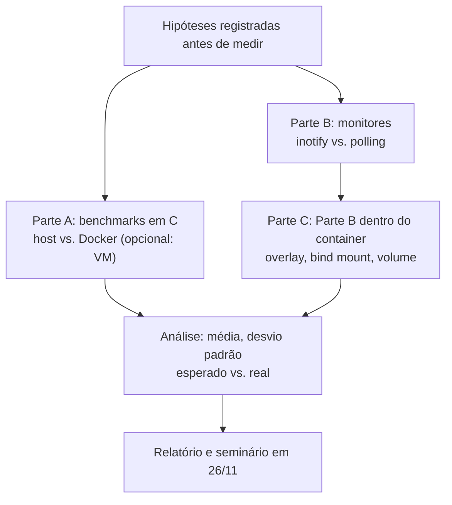

# Quanto custa a abstração? Medindo containers e monitoramento de arquivos no Linux

**Disciplina:** Sistemas Operacionais (UFG) · **Entrega:** Seminário (A02) em 26/11 · **Stack:** C, Git, Docker, VSCode

## 1. Ideia central

O SO oferece abstrações (containers, notificações de arquivo) e elas têm custo. Quanto custa, onde, e quando vale a pena? Os dois experimentos são dois lados da mesma pergunta.

**Origem do tema:** juntamos duas propostas do grupo. O kernel simplificado era trabalhoso demais, e os agentes Python de monitoramento de arquivos não tinham pergunta de pesquisa. Agora ambos viram partes de um mesmo estudo empírico.

## 2. Perguntas de pesquisa

1. Quanto overhead um container Docker adiciona em operações básicas do SO (syscall, fork, context switch, I/O de disco, alocação de memória) em relação à execução nativa?
2. Como o monitoramento de arquivos via inotify se compara ao polling em uso de CPU, latência de detecção e perda de eventos, sob carga crescente?
3. O resultado do monitoramento muda dentro de um container? Volumes e overlayfs podem se comportar de forma diferente do filesystem nativo.

A pergunta 3 liga as duas partes e é o resultado mais original do trabalho.

## 3. Fluxograma

## 4. Metodologia

### Parte A: overhead de containers (C + Docker)

Micro-benchmarks em C, no host e dentro de um container (opcionalmente numa VM como terceiro ponto):

- Custo de syscall (`getpid` em loop)
- `fork` + `wait`
- Context switch (dois processos trocando dados por pipe)
- Throughput de leitura/escrita sequencial em disco
- Alocação de memória (`malloc`/`mmap`)

**Hipótese:** CPU e memória terão overhead próximo de zero (o container compartilha o kernel). Syscalls e I/O de disco podem diferir por causa de overlayfs, seccomp e limites de cgroups.

### Parte B: monitoramento de arquivos (Python, com C opcional)

Dois monitores detectam mudanças em um diretório:

- **Polling:** varre o diretório a cada X ms comparando mtime/hash
- **inotify:** o kernel avisa quando há mudança (`inotify_simple`, `watchdog` ou direto em C)

Um gerador de carga cria, altera e apaga arquivos em taxas de 10, 100, 1.000 e 10.000 eventos/s.

| Métrica | Observação |
|---|---|
| Uso de CPU do monitor | Medido por rodada |
| Latência de detecção | Tempo entre a mudança e a detecção |
| Eventos perdidos | Comparados com o log do gerador (a verdade) |
| Intervalo de polling | 50 ms vs. 1 s |

Visão de QA: o gerador é um teste de carga com oráculo, e a perda de eventos (estouro da fila do inotify, `IN_Q_OVERFLOW`) é um bug clássico de sistemas.

### Parte C: a ponte

Repetir a Parte B dentro do container com o diretório monitorado em:

- camada overlay do container
- bind mount do host
- volume Docker

Comparar latência e perda de eventos nos três casos.

## 5. Divisão de tarefas

| Pessoa | Papel |
|---|---|
| 1 | Metodologia de teste, gerador de carga, oráculo de eventos, análise de confiabilidade (QA) |
| 2 | Benchmarks em C e observação do kernel (strace, /proc, perf) |
| 3 | Monitores polling e inotify |
| 4 | Dockerfiles, automação dos experimentos, coleta de dados e gráficos |

## 6. Cronograma (5 semanas até 26/11)

| Semana | Atividade |
|---|---|
| 1 | Fechar perguntas e hipóteses, montar ambiente Docker e repositório |
| 2 | Benchmarks da Parte A e monitores da Parte B funcionando |
| 3 | Rodar experimentos (várias repetições) e a Parte C |
| 4 | Análise, gráficos, esperado vs. real |
| 5 | Relatório, slides e ensaio da apresentação |

## 7. Cuidados

- **Medição confiável:** fixar a CPU quando possível, repetir cada teste no mínimo 10 vezes, descartar a primeira rodada (cache frio) e reportar média e desvio padrão.
- **Ambiente:** Docker no Windows/Mac roda numa VM Linux por baixo, o que contamina o "nativo". Usar Linux, WSL2 ou VM padronizada e declarar isso no relatório.
- **Escopo:** se o tempo apertar, a Parte A fica com 3 benchmarks e a Parte C com 2 tipos de montagem. O núcleo é B + C.
- **Integridade acadêmica:** registrar no relatório como foi usada IA generativa, conforme o Guia de Integridade Acadêmica da UFG.

## 8. Alinhamento com o plano de ensino

O roteiro do seminário pede: o que estudar e como, por que importa, perguntas, coleta e análise de dados, e esperado vs. real. Virtualização (containers) e sistemas de arquivos/I/O (inotify, overlayfs) são conteúdo da disciplina, e a stack é a indicada pelo professor.

## 9. Próximos passos

1. Criar o repositório Git com a estrutura de pastas
2. Escrever o Dockerfile base
3. Implementar o primeiro benchmark em C (`getpid` em loop)
4. Definir o ambiente padrão de medição do grupo
