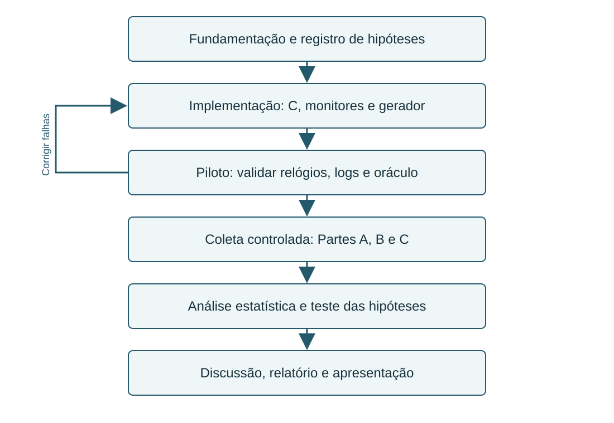

# Quanto custa a abstração?

**Medindo containers e monitoramento de arquivos no Linux**

Seminário INF0336 — Sistemas Operacionais, UFG. Professor Aldo Díaz. Apresentação em 26/11/2026.

## Equipe e apresentações

- 202003564 — GABRIEL FREITAS DOS REIS
- 202401787 — HENRIQUE SIQUEIRA DE MAGALHAES
- 202401795 — JÚLIA MANCINE OLIVEIRA E CARVALHO
- 202401826 — RODRIGO DE FIGUEIREDO SOARES

## Resumo

O estudo investiga o custo de operações do sistema operacional em Docker e compara polling com `inotify` no monitoramento de arquivos. Foram analisados cinco benchmarks em C e demonstrações com monitores Python, com dez rodadas válidas por condição. Na coleta pareada de 25/11, no mesmo Linux, com binários idênticos por hash e oito blocos de ordem alternada, o Docker padrão custou cerca de 5% em `getpid` (+4,9%, IC 95% ± 1,4) e na comunicação por pipe (+5,6%, ± 1,9). Esse custo é atribuível ao filtro seccomp: o Docker padrão ficou +5,3% e +5,0% acima do Docker sem seccomp nas mesmas métricas. `fork + wait`, alocação de memória e disco com bind mount ficaram dentro do ruído medido. Os valores da coleta histórica de 11/11 (`getpid` +38,7%, escrita sequencial +95,9%) não se reproduziram sob condições controladas. Na demonstração em container, `inotify` registrou 21 criações por rodada, enquanto polling de 50 ms registrou 1,2 em média. Os resultados valem para um único host.

## Introdução

Containers isolam processos e facilitam a reprodução de ambientes. Monitores de arquivos sustentam rotinas de sincronização, desenvolvimento e observabilidade. O custo desses recursos pode influenciar a escolha de como executar e monitorar uma aplicação.

Felter et al. [1] mostram que o desempenho relativo de Docker e KVM varia com a carga, motivando a análise por operação. A fila do `inotify` pode agrupar notificações idênticas e sinaliza saturação com `IN_Q_OVERFLOW` [2]. OverlayFS pode copiar arquivos preexistentes para a camada gravável (*copy-up*), enquanto volumes armazenam dados fora dessa camada [3, 4]. Mytkowicz et al. [5] mostram que a configuração experimental pode introduzir viés. Georges et al. [6] discutem como descrever a variabilidade com repetições e intervalos de confiança.

### Perguntas de pesquisa

1. Quanto Docker altera o custo de syscall, criação de processos, comunicação por pipe, I/O e alocação em relação ao Linux nativo?
2. Como polling e `inotify` se comparam em CPU, latência e operações não observadas sob carga crescente?
3. Como o monitoramento varia entre a camada gravável do container, bind mount e volume Docker?

### Hipóteses registradas antes das medições

- CPU e memória: overhead próximo de zero, pois o container compartilha o kernel do host.
- Syscalls e I/O de disco: possível diferença por causa de overlayfs, seccomp e limites de cgroups.
- `inotify`: menos CPU e menor latência que polling, mas com risco de perda de eventos sob carga alta (`IN_Q_OVERFLOW`).
- Dentro de container: latência/perda podem variar entre overlay, bind mount e volume.

## Metodologia

O grupo gerou os CSVs com benchmarks em C (`-O2`, `CLOCK_MONOTONIC`) e monitores em Python. Cada condição analisada tem dez rodadas após descarte da rodada de aquecimento (`run=0`); na coleta pareada, cada bloco tem dez rodadas válidas por ambiente e a análise usa o bloco como unidade amostral. As rodadas válidas foram mantidas integralmente. O [checkpoint](docs/relatorio/checkpoint-1.md) registra o protocolo original e a [reprodução da coleta](analysis/coleta_2026-11-23/REPRODUCAO.md) detalha comandos, parâmetros e análise.

- **Linux pareado, 25/11 (coleta principal da Parte A).** Mesmo host (Ryzen 7 5825U, x86-64, Btrfs), kernel `7.3.3-1-cachyos` em todos os ambientes, governor `performance` e CPU 2 fixada (`taskset` no nativo, `--cpuset-cpus` nos containers). Quatro ambientes: nativo no terminal, nativo em scope do systemd (`native-scope`, usado como baseline equivalente ao container), Docker padrão com bind mount e Docker sem seccomp. Os binários são estáticos e idênticos por hash SHA-256 em todos os ambientes. Oito blocos, cada um com os quatro ambientes em ordem alternada e dez rodadas válidas por métrica. [Dados e análise](bench_c/resultados/pareado_20261125_093021/) · [Diferenças por bloco](bench_c/resultados/pareado_20261125_093021/analise_pares.csv).
- **Linux histórico, 11/11.** Ryzen 7 5825U, x86-64 e Btrfs. A coleta nativa usou kernel `7.3.0-4-cachyos` e afinidade na CPU 2. O container com bind mount usou kernel `7.3.3-1-cachyos`, tinha uma CPU visível e não tinha afinidade registrada. A equivalência de compiladores e binários ficou sem confirmação. [CSV nativo](bench_c/resultados/native.csv) · [CSV Docker](bench_c/resultados_docker/docker-bind.csv).
- **Docker Desktop e macOS, 23/11.** Os cinco benchmarks C rodaram na VM Linux ARM64 e o disco foi medido em OverlayFS. Polling e `inotify` rodaram na camada gravável do container. O macOS executou apenas polling nativo. [Ambiente Docker](analysis/coleta_2026-11-23/docker-desktop/metadata.txt) · [Logs do macOS](analysis/coleta_2026-11-23/macos-native/).

### Cargas e critérios de avaliação

Em cada rodada no Docker Desktop foram executados 1 milhão de chamadas a `getpid`, 2 mil ciclos de `fork + wait` e 100 mil idas e voltas por pipe. O teste de disco usou um arquivo de 64 MiB e incluiu `fsync` na escrita. O teste de alocação distinguiu `malloc/free`, mapeamento com `mmap` e mapeamento com acesso às páginas. O pipe mede comunicação e escalonamento em conjunto. Na coleta pareada, cada rodada usou 1.000.000 chamadas a `getpid`, 2.000 ciclos de `fork + wait`, 100.000 idas e voltas por pipe, arquivo de 64 MiB com dados pseudoaleatórios, 5.000.000 pares `malloc/free` e 4.000 iterações de cada teste `mmap`.

Cada demonstração cria, altera e apaga um arquivo com pausas de 500 ms e depois cria e apaga outros 20 sem pausa. Polling verifica tamanho e `mtime` a cada 50 ms. Os logs contabilizam notificações por tipo e registram overflow quando sinalizado pelo `inotify`.

As métricas C são tempo por operação, página ou ida e volta no pipe e throughput em MiB/s. Os resumos calculam média, desvio padrão amostral e IC de 95% da média a partir dos valores por rodada. O gráfico usa `100 × (média Docker / média nativa − 1)`. CPU, latência e perda de operações ficam pendentes de coleta com carga controlada e log-oráculo.

**Análise da coleta pareada.** Cada métrica é resumida, em cada bloco, pela mediana das dez rodadas válidas de cada ambiente. Em cada bloco calcula-se a diferença percentual entre dois ambientes, `100 × (A − B) / B`, e as oito diferenças (uma por bloco) são resumidas por média e IC de 95% (t de Student, 7 graus de liberdade, valor crítico 2,365). Uma diferença é considerada detectável quando o intervalo exclui zero. Como os ambientes de um mesmo bloco são medidos com poucos minutos de intervalo, a deriva lenta da máquina afeta todos quase igualmente e tende a se cancelar na diferença; a variação do nativo entre blocos (coeficiente de variação das medianas) ficou entre 1,6% e 5,9%. A ordem dos ambientes em cada bloco segue um desenho de Williams para quatro ambientes: cada ambiente ocupa cada posição e segue cada outro o mesmo número de vezes. Quatro comparações: nativo em scope × nativo no terminal (efeito do ambiente de execução do baseline), Docker padrão × nativo em scope (custo total do Docker), Docker sem seccomp × nativo em scope (custo do isolamento) e Docker padrão × Docker sem seccomp (custo do seccomp).

O protocolo completo prevê cargas de 10, 100, 1.000 e 10.000 operações/s e polling a cada 50 e 1.000 ms. O log-oráculo deve registrar as operações realizadas com timestamps monotônicos para associá-las às notificações, medir o atraso de detecção e identificar operações sem correspondência.

### Reprodução

No macOS, `make run_docker_macos` executa os benchmarks e a demonstração em container. `python3 analysis/build_seminar_results.py` reconstrói os resumos a partir dos dados preservados. Para uma nova comparação no mesmo Linux, o alvo é `make run_linux_comparison`. A coleta pareada de 25/11 é reproduzida no mesmo Linux com `cd bench_c && ./coleta_pareada.sh 8 10 2` (8 blocos, 10 rodadas, CPU 2): o script recompila os binários de forma estática, reconstrói a imagem Docker, confere os hashes e roda os blocos. Depois, `python3 analisar_pares.py resultados/pareado_<data>` gera `analise_pares.csv` e `medianas_por_bloco.csv`. Exige Docker; o ambiente `native-scope` exige `sudo` sem senha. [Procedimento completo](analysis/coleta_2026-11-23/REPRODUCAO.md).

## Resultados

### Benchmarks em C

#### Coleta pareada no mesmo Linux (25/11)

Diferença percentual entre ambientes: média das oito diferenças por bloco ± metade do IC de 95%. Para tempo, positivo significa mais lento; para vazão de disco, positivo significa mais rápido. **Negrito**: o intervalo exclui zero.

| Métrica (nativo no terminal) | Docker padrão × nativo equivalente | Seccomp: padrão × sem seccomp | Isolamento: sem seccomp × nativo equivalente |
|---|---:|---:|---:|
| `getpid` (304,3 ns/op) | **+4,9% ± 1,4** | **+5,3% ± 1,7** | −0,3% ± 1,8 |
| `fork + wait` (71.278 ns/op) | +3,5% ± 6,6 | +2,2% ± 5,7 | +1,3% ± 5,3 |
| Ida e volta por pipe (4.576 ns) | **+5,6% ± 1,9** | **+5,0% ± 1,1** | +0,5% ± 1,3 |
| malloc/free 64 B (4,8 ns/op) | −0,3% ± 4,6 | +0,6% ± 3,8 | −0,8% ± 4,7 |
| mmap/munmap 4 MiB (2.416 ns/op) | +1,7% ± 2,0 | **+3,4% ± 1,5** | −1,7% ± 1,8 |
| mmap com acesso às páginas (204,5 ns/página) | −0,7% ± 3,5 | −0,9% ± 2,9 | +0,3% ± 4,8 |
| Escrita sequencial (1.445 MiB/s) | +0,3% ± 1,9 | −0,7% ± 1,3 | +1,0% ± 1,9 |
| Leitura sequencial (1.854 MiB/s) | −1,2% ± 4,9 | −1,3% ± 4,1 | +0,1% ± 2,6 |

- **Custo total do Docker padrão.** Só `getpid` e pipe tiveram custo detectável, ambos positivos nos oito blocos. As demais métricas ficaram dentro do ruído.
- **Seccomp.** A diferença entre Docker padrão e Docker sem seccomp reproduz o custo observado: cerca de 16 ns por `getpid` (317,8 contra 301,9 ns) e cerca de 220 ns por ida e volta de pipe (4.575 contra 4.357 ns).
- **Isolamento.** Com o seccomp desligado, nenhuma das oito métricas diferiu do nativo equivalente.
- **Baseline.** O nativo em scope do systemd ficou 5,3% ± 0,8 mais rápido no pipe e 1,8% ± 1,4 mais lento em `mmap/munmap` que o nativo no terminal. Por isso a comparação principal usa o scope como baseline.
- **Precisão.** Em `fork + wait`, leitura, `malloc/free` e `mmap` com acesso às páginas os intervalos chegam a ±3,5% a ±7%. Nessas métricas só é possível afirmar que um efeito, se existir, é menor que essa ordem de grandeza.

[Diferenças por bloco](bench_c/resultados/pareado_20261125_093021/analise_pares.csv) · [Medianas por bloco](bench_c/resultados/pareado_20261125_093021/medianas_por_bloco.csv) · [Dados brutos](bench_c/resultados/pareado_20261125_093021/).

#### Linux histórico (11/11)

No Linux histórico, `getpid` levou 38,656% mais tempo e `fork + wait`, 2,025% mais tempo. O throughput de escrita foi 95,921% maior no Docker. Esses valores não se reproduziram na coleta pareada (`getpid` +4,9%, escrita +0,3% ± 1,9). As duas coletas históricas diferiam em kernel, fixação de CPU e condições da máquina, de modo que devem ser lidas como dados exploratórios, e não como estimativa do custo do Docker. [Comparação histórica](analysis/coleta_2026-11-23/linux-historico/comparison.csv).

#### Docker Desktop (23/11)

A execução no Docker Desktop caracteriza a VM Linux ARM64. [CSV e estatísticas do Docker Desktop](analysis/coleta_2026-11-23/docker-desktop/).

Média ± desvio padrão na VM Linux do Docker Desktop, com dez rodadas válidas.

| Benchmark | Média ± DP | Unidade |
|---|---:|---|
| malloc/free (64 B) | 9,040 ± 0,577 | ns/op |
| mmap/munmap (4 MiB) | 1.015,162 ± 40,055 | ns/op |
| mmap com acesso às páginas | 60,275 ± 4,371 | ns/página |
| Leitura sequencial | 5.096,167 ± 624,932 | MiB/s |
| Escrita sequencial | 1.100,786 ± 195,674 | MiB/s |
| fork + wait | 98.728,069 ± 26.178,993 | ns/op |
| Ida e volta por pipe | 9.461,325 ± 1.450,347 | ns/ida e volta |
| getpid | 122,604 ± 6,208 | ns/op |

[Resumo do Docker Desktop com IC de 95%](analysis/coleta_2026-11-23/docker-desktop/benchmarks_summary.csv).

### Monitoramento

Média de notificações por rodada em dez rodadas válidas por condição.

| Ambiente | Monitor | Criação | Modificação | Remoção | Overflow |
|---|---|---:|---:|---:|---|
| macOS nativo | Polling | 1,1 | 1,0 | 1,1 | Não se aplica |
| Docker Desktop | Polling | 1,2 | 1,0 | 1,2 | Não se aplica |
| Docker Desktop | `inotify` | 21,0 | 22,0 | 21,0 | 0 |

[Resumo por condição com desvio padrão e IC](analysis/coleta_2026-11-23/monitor_repetitions_summary.csv).

## Discussão

A coleta pareada responde parte das hipóteses registradas. Para CPU e memória, `fork + wait`, `malloc/free` e `mmap` com acesso às páginas ficaram dentro do ruído, com intervalos de 95% de ±2% a ±7%, e `mmap/munmap` mostrou +1,7% ± 2,0, que não é detectável: a hipótese de overhead próximo de zero é compatível com os dados, sem excluir efeitos menores que essa precisão. Para syscalls, a hipótese de diferença por seccomp se confirma: `getpid` e pipe custam cerca de 5% a mais no Docker padrão, e a diferença desaparece quando o seccomp é desligado, de modo que o isolamento em si (namespaces, cgroups e bind mount) não teve custo detectável. Para disco, leitura e escrita sequenciais com bind mount ficaram dentro de ±2% a ±5% do nativo; overlay e volume não foram medidos nos benchmarks em C. A variação por operação é coerente com a necessidade de avaliar cada carga separadamente [1].

Dois resultados mostram o peso da configuração experimental [5]. Primeiro, a coleta histórica sugeria `getpid` 38,7% mais lento e escrita 95,9% mais rápida no Docker; sob condições controladas (mesmo kernel, CPU fixa, binários idênticos por hash, ordem alternada), os valores foram +4,9% e +0,3% ± 1,9. As coletas históricas diferiam em kernel, fixação de CPU e condições da máquina, e não isolamos qual fator produziu cada discrepância. Segundo, o mesmo binário nativo ficou 5,3% ± 0,8 mais lento no pipe quando rodado no terminal do que em um scope do systemd; comparado apenas ao nativo do terminal, o container pareceria mais rápido no pipe. A causa não foi isolada (a profundidade da hierarquia de cgroups e o uso de cpuset são candidatos), e por isso a comparação principal usa o scope como baseline. Observação exploratória: um `perf record` do `bench_syscall` mostrou funções de seccomp do kernel apenas no container com seccomp, e um filtro que permite tudo teve custo semelhante ao do perfil padrão, o que indica que o custo vem da presença do filtro, e não do conteúdo do perfil. Esses testes foram curtos, com ordem fixa, e suas saídas não estão arquivadas no repositório. As repetições quantificam a variabilidade [6].

A rotina de leitura solicita ao sistema o descarte das páginas em cache antes da medição. Como essa solicitação pode ser ignorada, a média de 5.096 MiB/s na VM caracteriza a leitura nas condições do teste, com possível influência de cache e armazenamento virtualizado. Na coleta pareada, as escritas usam dados pseudoaleatórios para que a compressão do Btrfs não infle o throughput, e a leitura mantém a ressalva sobre o descarte de cache. A comparação de armazenamento também deve distinguir arquivos criados na camada gravável de arquivos já presentes na imagem, cuja alteração pode acionar `copy-up` [3].

A maioria dos arquivos efêmeros desapareceu entre varreduras do polling. O `inotify` registrou as 21 criações e remoções, com zero registros de overflow nessa carga. Um log-oráculo permitiria parear operações e notificações, levando em conta o agrupamento de eventos [2]. A hipótese sobre CPU, latência e overflow sob carga alta segue pendente. A hipótese sobre armazenamento exige repetir o monitoramento em overlay, bind mount e volume [3, 4], com a mesma carga e os mesmos intervalos em cada montagem.

### Limitações

- Um único host, um kernel e uma CPU, com oito blocos. Os resultados não se generalizam a outras máquinas nem a aplicações reais.
- A análise pareada contém 32 comparações a 95%; um ou dois resultados detectáveis podem ser acaso. `getpid` e pipe foram positivos nos oito blocos nas comparações com o Docker padrão; o efeito de `mmap/munmap` na comparação de seccomp é mais fraco (limite inferior do intervalo próximo de zero).
- Em `fork + wait`, leitura, `malloc/free` e `mmap` com acesso às páginas, a precisão (±3,5% a ±7%) não permite afirmar igualdade, apenas que um efeito eventual é pequeno.
- O disco foi medido só com bind mount em Btrfs. Overlay e volume não foram medidos nos benchmarks em C.
- A causa da diferença do pipe entre o nativo no terminal e no scope do systemd não foi isolada.
- Os monitores ainda não têm medição de CPU, latência e perda sob carga controlada.

## Conclusão

Na coleta pareada no mesmo Linux, com baseline equivalente, o custo detectável do Docker limitou-se a syscalls e comunicação por pipe (cerca de 5%), atribuído ao filtro seccomp. O isolamento em si, `fork + wait`, a alocação de memória e o disco com bind mount ficaram dentro do ruído medido (intervalos de ±2% a ±7%), e os valores extremos da coleta histórica de 11/11 não se reproduziram. Isso vale para um host e para as cargas medidas, e não sustenta uma faixa geral de overhead para outras cargas [1]. Na demonstração, `inotify` observou mais arquivos de vida curta que polling de 50 ms. A medição de CPU, latência e perda dos monitores sob carga controlada, e a comparação entre overlay, bind mount e volume, completariam os objetivos do estudo.

## Referências

[1] FELTER, Wes; FERREIRA, Alexandre; RAJAMONY, Ram; RUBIO, Juan. **An updated performance comparison of virtual machines and Linux containers**. In: IEEE INTERNATIONAL SYMPOSIUM ON PERFORMANCE ANALYSIS OF SYSTEMS AND SOFTWARE (ISPASS), 2015. [S. l.]: IEEE, 2015. Disponível em: [publicação](https://research.ibm.com/publications/an-updated-performance-comparison-of-virtual-machines-and-linux-containers). Acesso em: 23 nov. 2026.

[2] LINUX MAN-PAGES PROJECT. **inotify(7): Linux manual page**. [S. l.], [s. d.]. Disponível em: [publicação](https://man7.org/linux/man-pages/man7/inotify.7.html). Acesso em: 23 nov. 2026.

[3] BROWN, Neil. **Overlay Filesystem**. The Linux Kernel documentation. [S. l.], [s. d.]. Disponível em: [publicação](https://www.kernel.org/doc/html/latest/filesystems/overlayfs.html). Acesso em: 23 nov. 2026.

[4] DOCKER INC. **Volumes**. Docker Docs. [S. l.], [s. d.]. Disponível em: [publicação](https://docs.docker.com/engine/storage/volumes/). Acesso em: 23 nov. 2026.

[5] MYTKOWICZ, Todd; DIWAN, Amer; HAUSWIRTH, Matthias; SWEENEY, Peter F. **Producing wrong data without doing anything obviously wrong!** In: INTERNATIONAL CONFERENCE ON ARCHITECTURAL SUPPORT FOR PROGRAMMING LANGUAGES AND OPERATING SYSTEMS, 14., 2009, Washington, DC. Proceedings [...]. New York: ACM, 2009. p. 265–276. DOI: https://doi.org/10.1145/1508244.1508275. Disponível em: [publicação](https://sape.inf.usi.ch/publications/asplos09.html). Acesso em: 23 nov. 2026.

[6] GEORGES, Andy; BUYTAERT, Dries; EECKHOUT, Lieven. **Statistically rigorous Java performance evaluation**. In: ACM SIGPLAN CONFERENCE ON OBJECT-ORIENTED PROGRAMMING SYSTEMS AND APPLICATIONS, 2007, Montreal. Proceedings [...]. New York: ACM, 2007. p. 57–76. DOI: https://doi.org/10.1145/1297027.1297033. Disponível em: [publicação](https://users.elis.ugent.be/~leeckhou/papers/oopsla07-stat.pdf). Acesso em: 23 nov. 2026.