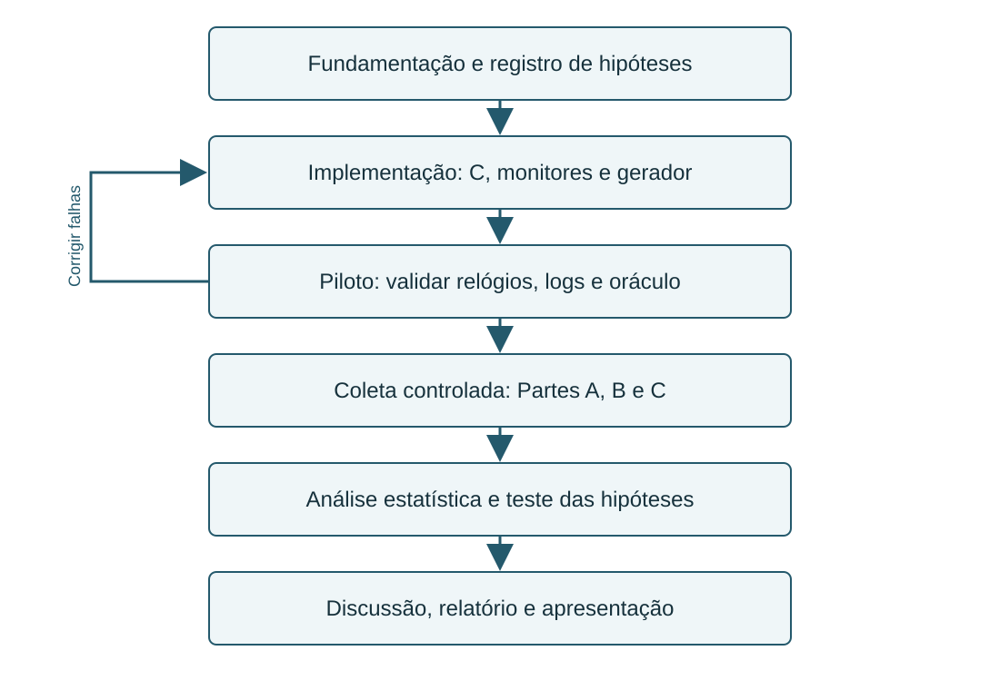

# INF0336 — Seminário: primeiro checkpoint

## Título do Seminário

**Quanto custa a abstração? Medindo containers e monitoramento de arquivos no Linux**

## Equipe

TODO: preencher matrícula e nome completo dos quatro integrantes antes da entrega.

Disciplina: INF0336 — Sistemas Operacionais, UFG. Professor: Aldo Díaz.

## Apresentações

1. Primeiro checkpoint: TODO: inserir o link dos slides publicados pelo grupo.

## Resumo

Containers e mecanismos de notificação de arquivos oferecem recursos úteis para executar aplicações e observar mudanças no sistema de arquivos. Entretanto, seus custos dependem da carga e da configuração do ambiente. Este projeto investigará o overhead de containers Docker e comparará o monitoramento de arquivos com polling e `inotify` no Linux. A avaliação utilizará micro-benchmarks em C e monitores em Python, executados sob condições controladas. Um gerador produzirá operações de arquivos com registro de referência, permitindo avaliar CPU, latência e cobertura das operações detectadas. Os experimentos compararão execução nativa e containers com diferentes formas de armazenamento, com repetições e análise da variabilidade. Espera-se observar baixo overhead em algumas operações de CPU e memória, além de diferenças mais sensíveis ao armazenamento e à carga no monitoramento. Essas expectativas são hipóteses e ainda não representam resultados do grupo. Neste checkpoint, apresentam-se a fundamentação e o protocolo proposto, enquanto a implementação em C está em desenvolvimento. O estudo pretende identificar em quais condições essas abstrações apresentam custos relevantes para as aplicações.

## Introdução

### Motivação e delimitação

Aplicações precisam de ambientes de execução reproduzíveis e de mecanismos para perceber alterações em arquivos. Containers atendem à primeira necessidade ao empacotar aplicações e isolar processos, enquanto o monitoramento de arquivos aparece em ferramentas de desenvolvimento e rotinas de sincronização e observabilidade. Esses recursos utilizam serviços do sistema operacional, cujo custo pode variar conforme a operação e o ambiente.

O projeto estudará duas situações relacionadas. A Parte A comparará operações básicas em C, executadas diretamente em Linux e em containers Docker. A Parte B comparará polling e `inotify` no monitoramento de diretórios. A Parte C conectará os experimentos ao repetir o monitoramento em diferentes configurações de armazenamento de containers. O trabalho avaliará uma configuração experimental explicitamente documentada, sem pretender estabelecer um custo universal para containers ou generalizar micro-benchmarks para todas as aplicações.

### Revisão bibliográfica

Felter et al. (2015) comparam Docker e KVM e observam desempenho igual ou superior dos containers ao das máquinas virtuais na maioria das cargas estudadas. Também destacam a necessidade de ajustes em aplicações intensivas em I/O. Esse resultado motiva a separação das operações neste projeto, mas não demonstra que Docker tenha overhead zero em relação à execução nativa em qualquer configuração [1].

O manual de `inotify` descreve notificações de alterações em arquivos e diretórios, incluindo criação, modificação e remoção. A fila tem capacidade limitada e registra `IN_Q_OVERFLOW` quando transborda. Além disso, eventos idênticos consecutivos podem ser agrupados antes da leitura. Assim, contar notificações não equivale necessariamente a contar operações realizadas pela aplicação [2]. Neste projeto, a avaliação distinguirá operações não observadas, agrupamento e ocorrência explícita de overflow.

A documentação do kernel descreve como OverlayFS combina camadas e realiza *copy-up* quando uma operação exige copiar um arquivo da camada inferior para a superior [3]. A documentação do Docker explica que volumes armazenam os dados fora da camada gravável do container, evitando o caminho de escrita dessa camada [4]. Essas fontes justificam comparar camada overlay, bind mount e volume, sem assumir antecipadamente uma ordem de desempenho para a latência dos monitores. Arquivos criados diretamente na camada superior não exercitam o mesmo caminho de *copy-up* de arquivos preexistentes na imagem.

Mytkowicz et al. (2009) mostram que escolhas aparentemente pequenas na configuração podem introduzir viés nas medições de desempenho [5]. Georges, Buytaert e Eeckhout (2007) discutem a importância de repetições e intervalos de confiança, em um estudo voltado a Java [6]. O presente trabalho adotará os princípios de explicitar a configuração e quantificar a variabilidade, sem transferir resultados numéricos de Java para C ou Python. Repetir uma configuração enviesada não elimina seu viés.

### Objetivos e perguntas de pesquisa

**Objetivo geral:** avaliar os custos de execução e de observação de eventos associados a containers e ao monitoramento de arquivos no Linux.

| Pergunta | Experimento e objetivo específico |
|---|---|
| Q1. Quanto Docker altera o custo de operações básicas do SO? | Comparar syscall, criação de processos, comunicação por pipe, I/O e alocação de memória entre execução nativa e container. |
| Q2. Como polling e `inotify` se comparam sob carga crescente? | Medir CPU, latência e operações não observadas para diferentes taxas e intervalos de polling. |
| Q3. O armazenamento do container altera o monitoramento? | Repetir a comparação em camada overlay, bind mount e volume Docker. |

### Hipóteses registradas antes das medições

Reprodução das hipóteses da proposta original, sem alteração após resultados:

- CPU e memória: overhead próximo de zero, pois o container compartilha o kernel do host.
- Syscalls e I/O de disco: possível diferença por causa de overlayfs, seccomp e limites de cgroups.
- `inotify`: menos CPU e menor latência que polling, mas com risco de perda de eventos sob carga alta (`IN_Q_OVERFLOW`).
- Dentro de container: latência/perda podem variar entre overlay, bind mount e volume.

**Nota metodológica anterior à coleta:** compartilhar o kernel fundamenta uma expectativa, mas não garante igualdade de desempenho. O experimento básico estima a diferença do conjunto da configuração. Atribuir uma diferença especificamente a seccomp, cgroups ou OverlayFS exigiria variar esse fator isoladamente.

## Metodologia

### Conjunto de dados e desenho experimental

Os dados serão produzidos pelo grupo, a partir dos experimentos descritos abaixo. Não será utilizado um dataset externo como resultado experimental. A unidade de repetição estatística será uma execução completa de uma condição, e não cada evento individual de uma mesma execução.

| Parte | Fatores planejados | Medidas principais |
|---|---|---|
| A | Execução nativa × Docker, por micro-benchmark | Tempo por operação, throughput e diferença relativa |
| B | Polling × `inotify`, taxas de 10, 100, 1.000 e 10.000 operações/s | CPU, latência e operações não observadas |
| C | Nativo × Docker-overlay × Docker-bind × Docker-volume | Mesmas medidas da Parte B por armazenamento |

Os intervalos iniciais de polling serão 50 ms e 1.000 ms. A duração proposta de cada rodada de monitoramento é 30 s, com 2 s adicionais para escoamento das notificações. Cada combinação terá uma rodada inicial de aquecimento, excluída da análise principal, seguida de pelo menos dez rodadas válidas. Duração e escoamento serão verificados no piloto e qualquer ajuste será documentado antes da coleta principal. A taxa efetivamente alcançada será registrada, pois 10.000 operações/s é uma meta de carga e não uma capacidade já demonstrada.

### Tecnologias e infraestrutura

Os micro-benchmarks utilizarão C com flags padronizadas (`-O2`) e `clock_gettime(CLOCK_MONOTONIC)`. Serão implementados testes de `getpid`, `fork` com `wait`, troca de bytes por pipe, leitura/escrita sequencial e alocação com `malloc`/`mmap`. A revisão verificará se o compilador preserva o trabalho medido. O teste por pipe incluirá custos de comunicação e escalonamento, não apenas um custo puro de context switch. Os testes de memória distinguirão alocação de acesso efetivo às páginas. Os de disco informarão tamanho, cache e uso de `fsync` ou `O_DIRECT`, sem tratar mecanismos diferentes como equivalentes.

Os monitores em Python compartilharão a interface e o formato de log definidos no projeto. Polling comparará metadados entre varreduras. `inotify` observará eventos do kernel e registrará overflow. O gerador e o monitor executarão na mesma instância Linux, com relógio monotônico em nanossegundos. Será verificado se existe configuração de time namespace que desloque o relógio do container. Os logs ficarão fora do diretório observado.

O ambiente preferencial é uma máquina Linux. Se houver apenas VM, ambos os cenários, execução direta e Docker, executarão dentro da mesma VM Linux, com essa condição declarada. Comparar um programa no macOS com outro no Linux do Docker Desktop introduziria diferenças de kernel e virtualização. CPU, memória, kernel, filesystem, Docker, compilador, Python, imagem e dependências serão registrados com versões exatas e commit. **TODO:** selecionar a máquina e fixar essas versões antes da coleta.

No cenário overlay, ambos os processos executarão no container e acessarão seu diretório gravável. Nos cenários bind e volume, ambos acessarão a mesma montagem. A origem das escritas será mantida dentro do ambiente avaliado para evitar confundir tipo de armazenamento e origem do evento. O piloto verificará o filesystem e o driver reais. Diretórios de carga serão temporários (`/tmp/...`), com registro do filesystem subjacente, pois `/tmp` pode ser tmpfs. Nos containers, `/tmp` não deverá ser montado como tmpfs no cenário overlay.

### Oráculo e correspondência entre operações e detecções

O gerador registrará `ts_ns,op,path` para operações bem-sucedidas, com timestamp imediatamente anterior à chamada que altera o arquivo. Esse instante define a latência de ponta a ponta, incluindo o tempo da chamada. Falhas terão registro separado e não entrarão como operações concluídas. A análise só ocorrerá após consolidar o oráculo. O monitor registrará `ts_detect_ns,event_type,path`, e o uso de CPU ficará em arquivo separado.

O piloto validará a correspondência por tipo, caminho e ordem temporal. Criação, modificação e remoção terão séries separadas, com caminhos únicos por operação dentro de cada série. Na série de modificação, arquivos serão preparados antes da medição e modificados uma única vez. Na de remoção, arquivos também serão preparados antecipadamente. O monitor concluirá seu estado inicial antes do início da carga, e haverá sinalização de prontidão.

Esse desenho permite identificar operações sem reutilizar repetidamente o mesmo caminho. Uma série complementar poderá exercitar alterações repetidas no mesmo arquivo para estudar agrupamento e estados intermediários, mas não será misturada à estimativa principal. Uma criação pode produzir também notificação de modificação, que não será considerada automaticamente uma duplicação. Cada operação terá no máximo uma detecção correspondente na métrica principal. Registros adicionais serão classificados pela semântica da operação. Overflow será contado separadamente, sem inferir dele um número exato de eventos perdidos.

### Métricas

| Métrica | Definição operacional |
|---|---|
| Tempo por operação | Tempo do trecho medido dividido pelo número de operações concluídas, em ns/op |
| Throughput | Bytes processados por segundo, com modo de I/O documentado |
| Overhead de tempo | `100 × (tempo_docker / tempo_nativo − 1)`, por condição equivalente |
| Variação de throughput | `100 × (throughput_docker / throughput_nativo − 1)`; valor negativo indica redução |
| Latência | `ts_detect_ns − ts_ns` para pares válidos, reportando mediana e p95 por rodada |
| Operações não observadas | `100 × operações_sem_correspondência / operações_bem_sucedidas` |
| Registros adicionais | Detecções excedentes após correspondência e classificação semântica |
| CPU do monitor | `100 × Δ(tempo_CPU_usuário + tempo_CPU_sistema) / Δtempo_real`, relativo a um núcleo |
| Overflow | Quantidade de registros `IN_Q_OVERFLOW` por rodada |

Latência será calculada somente para operações detectadas e apresentada junto da cobertura. Uma latência pequena com muitas operações não observadas não indicará, isoladamente, um monitor superior. Operações sem correspondência não serão atribuídas automaticamente a falhas do kernel: polling pode deixar de observar estados entre varreduras e `inotify` pode agrupar notificações [2].

### Protocolo e análise

1. Registrar hipóteses, versões, configuração, carga e regras de correspondência.
2. Executar um piloto para validar relógios, prontidão, logs, taxa alcançada e escoamento.
3. Executar as condições sequencialmente, em ordem aleatória por bloco de repetição, preservando a semente da ordem.
4. Excluir a rodada inicial de aquecimento conforme regra prévia e coletar ao menos dez rodadas válidas por condição.
5. Preservar CSVs e metadados. Reportar média, desvio padrão e IC de 95% entre rodadas. Para médias aproximadamente normais, usar `média ± t(0,975; n−1) × s/√n`, explicitando a suposição.
6. Para latência, calcular mediana e p95 por rodada e resumir a variabilidade dessas medidas entre rodadas. Não tratar eventos correlacionados como repetições independentes.
7. Manter outliers válidos. Invalidar somente rodadas com falhas verificáveis do protocolo, registrar o motivo e repetir a condição. Reportar saturação, overflow e incapacidade de atingir a carga como resultados, sem excluí-los por apresentarem desempenho ruim.
8. Comparar as observações com as hipóteses e a literatura, discutindo os limites da configuração avaliada.

**Nota sobre cache:** descartar a primeira rodada é uma regra de aquecimento, não uma demonstração de cache frio nem de estabilização. Resultados de cache frio, se investigados, exigirão protocolo próprio. Instrumentação com `strace`/`perf`, quando disponível, será usada em execuções diagnósticas separadas para não confundir seu custo com o benchmark principal.

### Fluxograma

1. Fundamentação e registro de hipóteses.
2. Implementação dos benchmarks, monitores e gerador.
3. Piloto e validação dos contratos e do oráculo.
4. Coleta controlada das Partes A, B e C.
5. Análise estatística e comparação com as hipóteses.
6. Discussão, relatório e apresentação final.

### Organização e cronograma proposto

| Período | Entrega planejada |
|---|---|
| Primeiro checkpoint | Introdução fundamentada, perguntas, hipóteses e protocolo experimental |
| Até 12/11/2026 | Integrar componentes e concluir piloto |
| 13 a 19/11/2026 | Coletar experimentos e revisar qualidade dos dados |
| 20 a 25/11/2026 | Analisar, elaborar gráficos e ensaiar |
| 26/11/2026 | Apresentação final, conforme planejamento do projeto |

As datas intermediárias são uma proposta de organização do grupo. P1 cuidará do gerador, oráculo e análise, P2 dos benchmarks C, P3 dos monitores e P4 da infraestrutura e automação. Se necessário, o grupo reduzirá a Parte A a três benchmarks e a Parte C a duas montagens, mantendo B e C como núcleo e registrando o recorte antes da coleta.

## Resultados

**Estado neste checkpoint:** implementação em C em andamento, conforme informação do grupo. Não há resultados experimentais apresentados neste relatório. Os monitores, gerador e automação compõem o planejamento e ainda precisam de validação integrada.

| Resultado a produzir | Situação |
|---|---|
| Tempo/throughput nativo × Docker | TODO: coletar e analisar |
| CPU e latência dos monitores por carga | TODO: coletar e analisar |
| Operações não observadas e overflow por armazenamento | TODO: coletar e analisar |

Os gráficos futuros mostrarão variabilidade entre rodadas. As taxas e durações acima são parâmetros propostos, não resultados medidos.

## Discussão

O estudo de Felter et al. [1] orienta a avaliação por tipo de carga, enquanto as documentações [2–4] ajudam a interpretar possíveis efeitos de notificações e armazenamento. Os trabalhos de metodologia [5–6] fundamentam os cuidados com viés e variabilidade. Após a coleta, cada hipótese será confrontada com os resultados do grupo e com essas fontes. Ainda não é possível confirmar ou rejeitar hipóteses.

As principais ameaças à validade são cache, escalonamento, resolução e custo da instrumentação, interferência do gerador, limites da máquina e diferenças entre implementações. Uma única máquina limita a generalização. O estudo básico compara configurações completas e não permite atribuir causalidade isolada a cada mecanismo interno do Docker.

## Conclusão

O primeiro checkpoint delimita o problema, apresenta a fundamentação e estabelece uma proposta de medição. A parte em C está em desenvolvimento. A próxima etapa será integrar os componentes e validar o piloto antes de coletar os dados principais. A contribuição esperada é uma comparação reproduzível dos custos e limites dessas abstrações nas condições avaliadas.

## Referências

[1] FELTER, Wes; FERREIRA, Alexandre; RAJAMONY, Ram; RUBIO, Juan. **An updated performance comparison of virtual machines and Linux containers**. In: IEEE INTERNATIONAL SYMPOSIUM ON PERFORMANCE ANALYSIS OF SYSTEMS AND SOFTWARE (ISPASS), 2015. [S. l.]: IEEE, 2015. Disponível em: https://research.ibm.com/publications/an-updated-performance-comparison-of-virtual-machines-and-linux-containers. Acesso em: 4 nov. 2026.

[2] LINUX MAN-PAGES PROJECT. **inotify(7): Linux manual page**. [S. l.], [s. d.]. Disponível em: https://man7.org/linux/man-pages/man7/inotify.7.html. Acesso em: 4 nov. 2026.

[3] BROWN, Neil. **Overlay Filesystem**. The Linux Kernel documentation. [S. l.], [s. d.]. Disponível em: https://www.kernel.org/doc/html/latest/filesystems/overlayfs.html. Acesso em: 4 nov. 2026.

[4] DOCKER INC. **Volumes**. Docker Docs. [S. l.], [s. d.]. Disponível em: https://docs.docker.com/engine/storage/volumes/. Acesso em: 4 nov. 2026.

[5] MYTKOWICZ, Todd; DIWAN, Amer; HAUSWIRTH, Matthias; SWEENEY, Peter F. **Producing wrong data without doing anything obviously wrong!** In: INTERNATIONAL CONFERENCE ON ARCHITECTURAL SUPPORT FOR PROGRAMMING LANGUAGES AND OPERATING SYSTEMS, 14., 2009, Washington, DC. Proceedings [...]. New York: ACM, 2009. p. 265–276. DOI: https://doi.org/10.1145/1508244.1508275. Disponível em: https://sape.inf.usi.ch/publications/asplos09.html. Acesso em: 4 nov. 2026.

[6] GEORGES, Andy; BUYTAERT, Dries; EECKHOUT, Lieven. **Statistically rigorous Java performance evaluation**. In: ACM SIGPLAN CONFERENCE ON OBJECT-ORIENTED PROGRAMMING SYSTEMS AND APPLICATIONS, 2007, Montreal. Proceedings [...]. New York: ACM, 2007. p. 57–76. DOI: https://doi.org/10.1145/1297027.1297033. Disponível em: https://users.elis.ugent.be/~leeckhou/papers/oopsla07-stat.pdf. Acesso em: 4 nov. 2026.
